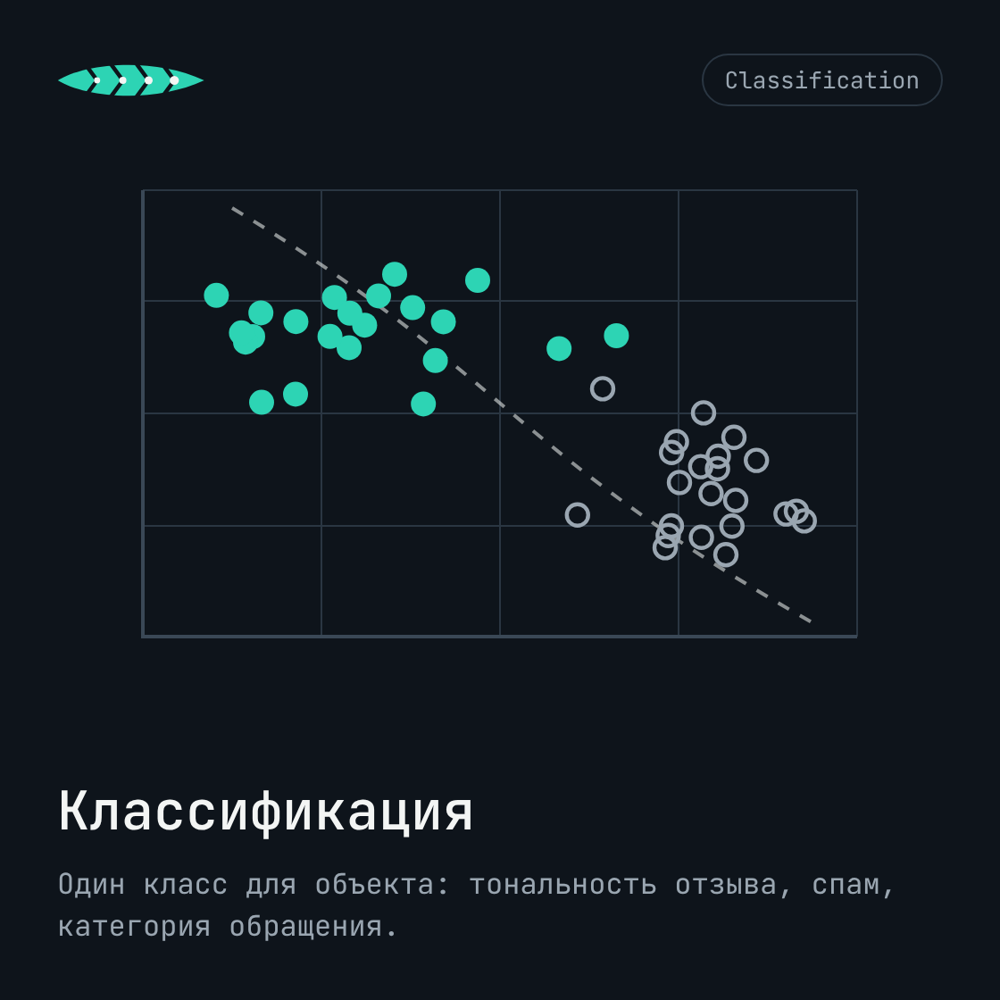
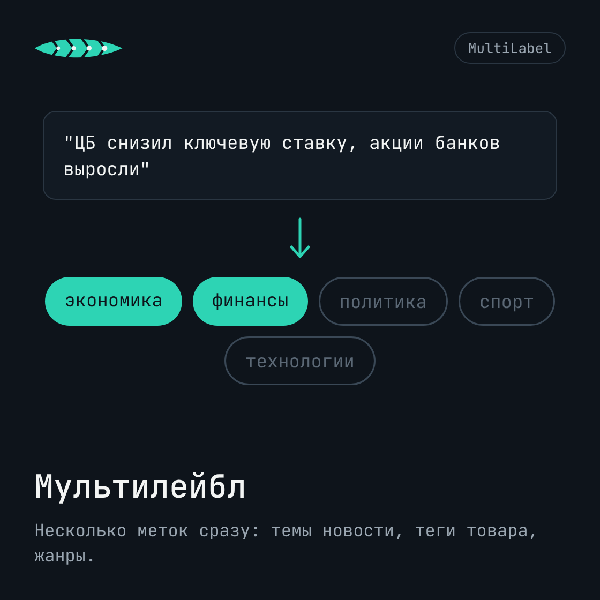
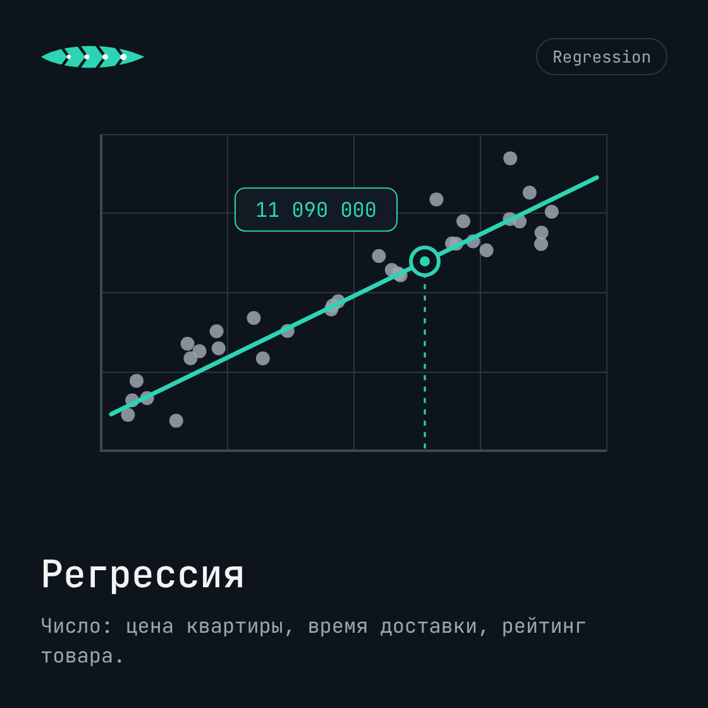
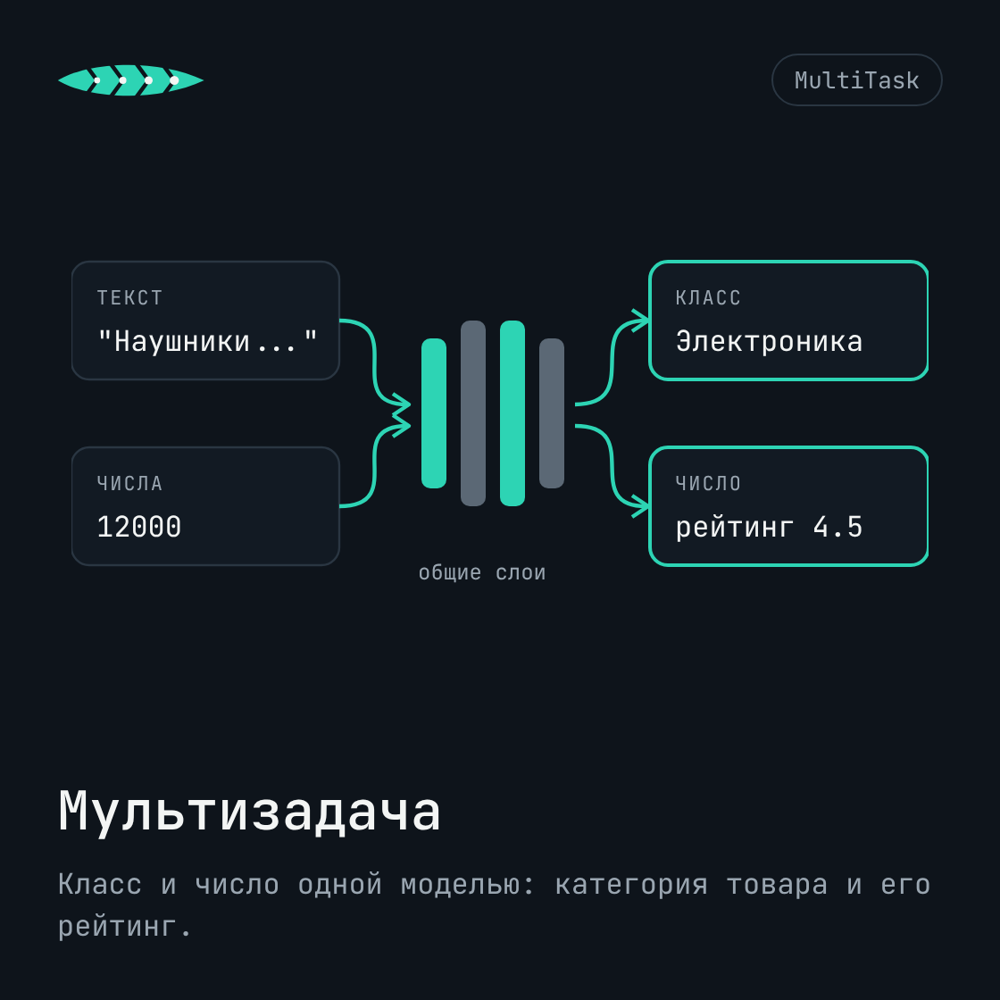

<p align="center">
  
</p>

<p align="center">
  <a href="https://pypi.org/project/lancetnic/"></a>
  <a href="https://pepy.tech/project/lancetnic"></a>
  <a href="https://pypi.org/project/lancetnic/"></a>
  <a href="https://opensource.org/licenses/MIT"></a>
</p>

<p align="center">
  <a href="https://lancetnic.ru/"><b>Сайт</b></a> &nbsp;·&nbsp;
  <a href="https://github.com/Lancet52/lancetnic/blob/main/lancetnic/docs/images/RU_documentation.md"><b>Документация</b></a> &nbsp;·&nbsp;
  <a href="https://t.me/markovstate"><b>Telegram</b></a> &nbsp;·&nbsp;
  <a href="https://pypi.org/project/lancetnic/"><b>PyPI</b></a>
</p>

<br>

**LANCETNIC** - это библиотека, которая представляет базовый набор для решения задач по поиску взаимосвязей между признаками объекта и целевой переменной. Решение построено на парадигме обучения с учителем: модель обучается на размеченных данных, где каждому объекту сопоставлена соответствующая метка (целевая переменная).

Вы даёте CSV с размеченными примерами. LANCETNIC векторизует текст и числа, обучает нейросеть на PyTorch, сохраняет лучшую модель и строит графики метрик. Дальше одна строка, и модель отвечает на новых данных.

```bash
pip install lancetnic
```

<br>

## Почему LANCETNIC

<p align="center">
  
</p>

- **Ваши данные.** Модель учится на вашей разметке и подстраивается под вашу предметную область.
- **Обычное железо.** Лёгкие сети вместо больших языковых моделей. Хватает процессора, видеокарта только ускоряет обучение.
- **Пара строк кода.** Векторизация, деление выборки, обучение и метрики уже внутри.
- **Всё сохраняется.** Модели, графики, метрики по эпохам и параметры запуска складываются в отдельную папку.

<br>

## Решаемые задачи

<p align="center">
  
  
</p>
<p align="center">
  
  
</p>

| Задача | Пайплайн | Что предсказывает | Пример |
|---|---|---|---|
| Классификация | `Classification` | Один класс | Тональность отзыва, спам, категория обращения |
| Мультилейбл | `MultiLabel` | Несколько меток сразу | Темы новости, теги товара |
| Регрессия | `Regression` | Число | Цена квартиры, время доставки |
| Мультизадача | `MultiTask` | Класс и число | Категория товара и его рейтинг |

Признаки могут быть текстовыми, числовыми или смешанными: например, текст отзыва вместе с ценой и сроком доставки.

<br>

## Быстрый старт

```python
from lancetnic import Classification
from lancetnic.models import LancetMCA

# 1. Описываем данные: какие столбцы CSV признаки, какой ответ
clf = Classification(text_column=['review'],
                     data_column=['price'],
                     label_column='label')

# 2. Обучаем
clf.train(model_name=LancetMCA,
          train_path='reviews.csv',
          val_path=None,
          num_epochs=20)

# 3. Пользуемся
result = clf.predict(model_path='runs/train/train_0/best_model.pt',
                     text_data=['Доставили быстро, всё работает'],
                     scalar_data=[1290],
                     return_proba=True)

print(result['label'], round(result['prob'], 2))   # позитив 0.91
```

<br>

## Как это работает

<p align="center">
  
</p>

1. **Данные.** Обучающий CSV и, по желанию, отдельный валидационный. Без него валидация отрезается автоматически.
2. **Векторизация.** Текст превращается в TF-IDF или в последовательность слов, числа нормируются.
3. **`train()`.** Обучение с выбранной моделью, оптимизатором и функцией потерь. На GPU, если он есть, иначе на CPU.
4. **`predict()`.** Векторайзеры и кодировщики меток хранятся внутри файла модели, поэтому на вход подаются обычные строки и числа.
5. **`tune()` и `finetune()`.** Подбор гиперпараметров через Optuna и дообучение готовой модели на новых данных.

<br>

## Что вы получаете

<p align="center">
  
</p>

После каждого запуска в папке `runs/train/train_N/` лежат:

- `best_model.pt` и `last_model.pt`: лучшая модель по `val_loss` и модель после последней эпохи;
- `result.csv` и `hyperparams.yaml`: метрики по эпохам и параметры запуска;
- графики: loss, accuracy, F1, precision, recall, матрица ошибок, распределение классов. Для регрессии MAE, RMSE и график «предсказание против факта», для мультилейбла Hamming loss и F1 по каждой метке.

<br>

## Модели

<p align="center">
  
</p>

Две линейки моделей названы в честь хирургических инструментов:

- **Scalpel**: полносвязные сети. Быстро обучаются и хорошо работают на табличных данных и TF-IDF.
- **Lancet**: LSTM и GRU, в том числе с механизмом внимания. Читают текст по порядку слов.

Можно подключить и свою архитектуру на PyTorch: требования к ней описаны в [документации](https://github.com/Lancet52/lancetnic/blob/main/lancetnic/docs/images/RU_documentation.md#своя-архитектура-модели).

<br>

## Что нового в 5.0.0

<p align="center">
  
</p>

- **Мультилейбл классификация**: пайплайн `MultiLabel` и модель `ScalpelMLabel`.
- **Режим `text_mode='sequence'`**: модели читают слова по порядку, а не «мешком». В 5.0.0 работает в классификации с `LancetMC`, `LancetMCA` и `LancetMCA_gru`.
- **Вероятности классов**: `predict(..., return_proba=True)` возвращает уверенность модели.
- **Дообучение**: `finetune()` продолжает обучение сохранённой модели на новых данных.
- **Подбор гиперпараметров**: `tune()` на базе Optuna.
- **Регрессия**: целевая переменная нормируется автоматически, ответ возвращается в исходных единицах.

<br>

## Установка

Нужен Python 3.10 или новее.

```bash
pip install lancetnic
```

Для обучения на видеокарте NVIDIA сначала установите PyTorch с поддержкой CUDA. Команду под свою систему возьмите на [pytorch.org](https://pytorch.org/get-started/locally/), например:

```bash
pip install torch --index-url https://download.pytorch.org/whl/cu124
pip install lancetnic
```

<br>

## Документация

Полное описание параметров, примеры наборов данных и FAQ: **[RU_documentation.md](https://github.com/Lancet52/lancetnic/blob/main/lancetnic/docs/images/RU_documentation.md)**

| Раздел | Что внутри |
|---|---|
| [Подготовка данных](https://github.com/Lancet52/lancetnic/blob/main/lancetnic/docs/images/RU_documentation.md#подготовка-данных) | Какие столбцы куда передавать |
| [Классификация](https://github.com/Lancet52/lancetnic/blob/main/lancetnic/docs/images/RU_documentation.md#классификация) | `Classification`, вероятности классов |
| [Мультилейбл](https://github.com/Lancet52/lancetnic/blob/main/lancetnic/docs/images/RU_documentation.md#мультилейбл-классификация) | `MultiLabel`, порог и `top_k` |
| [Регрессия](https://github.com/Lancet52/lancetnic/blob/main/lancetnic/docs/images/RU_documentation.md#регрессия) | `Regression` |
| [Многозадачное обучение](https://github.com/Lancet52/lancetnic/blob/main/lancetnic/docs/images/RU_documentation.md#многозадачное-обучение) | `MultiTask`, веса потерь |
| [Дообучение](https://github.com/Lancet52/lancetnic/blob/main/lancetnic/docs/images/RU_documentation.md#дообучение-finetune) | `finetune()` |
| [Подбор гиперпараметров](https://github.com/Lancet52/lancetnic/blob/main/lancetnic/docs/images/RU_documentation.md#подбор-гиперпараметров-tune) | `tune()` |

<br>

## Автор и связь

- GitHub: [Lancet52](https://github.com/Lancet52)
- Сайт: [lancetnic.ru](https://lancetnic.ru/)
- Telegram: [@markovstate](https://t.me/markovstate)
- E-mail: `lancetFPV@yandex.ru`

Библиотека распространяется по лицензии MIT.

<br>

<p align="center">
  <sub>LANCETNIC · Ваши данные - ваша модель</sub>
</p>
