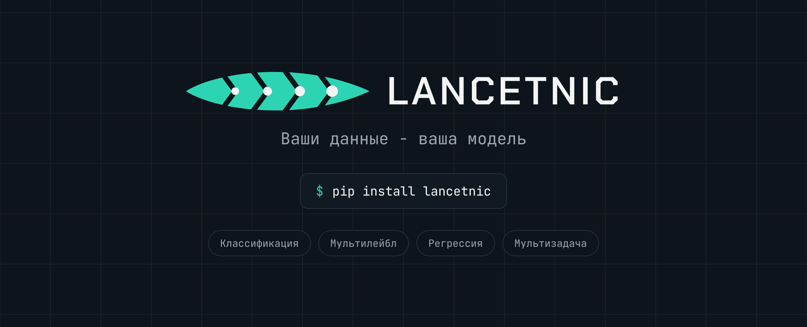
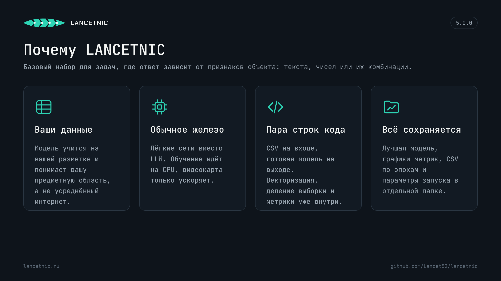
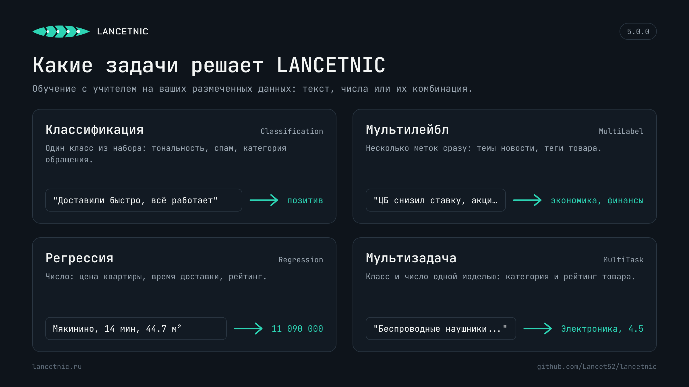
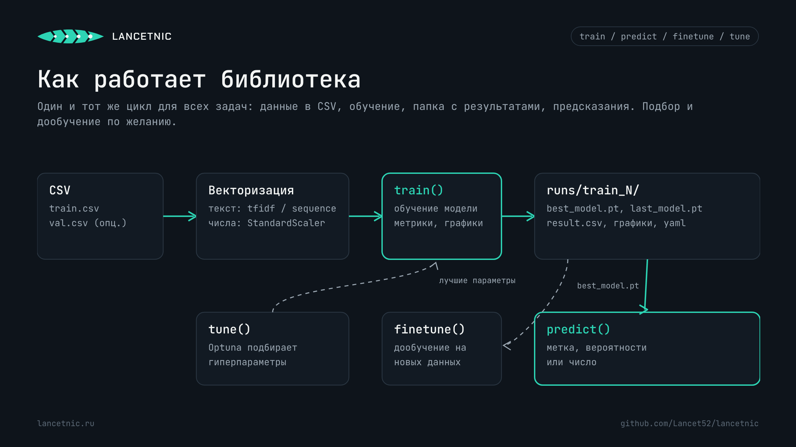
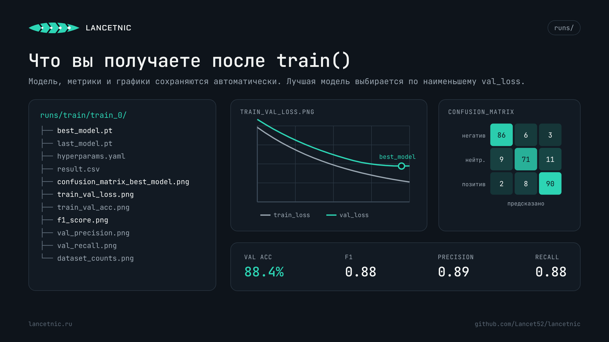
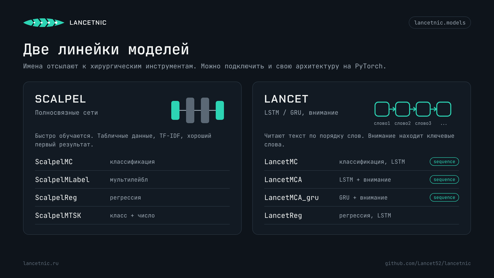
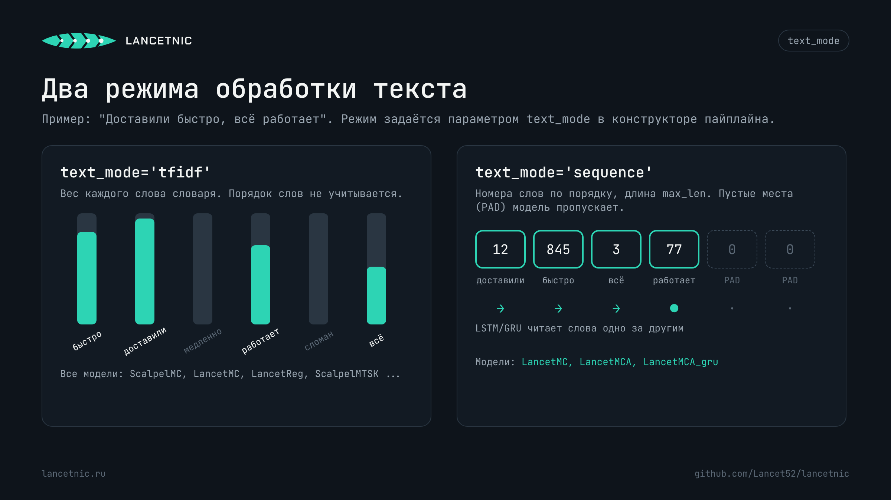

<p align="center">
  
</p>

<p align="center">
  <a href="https://pypi.org/project/lancetnic/"></a>
  <a href="https://pepy.tech/project/lancetnic"></a>
  <a href="https://pypi.org/project/lancetnic/"></a>
  <a href="https://opensource.org/licenses/MIT"></a>
</p>

<p align="center">
  <a href="https://lancetnic.ru/"><b>Сайт</b></a> &nbsp;·&nbsp;
  <a href="https://github.com/Lancet52/lancetnic/blob/main/lancetnic/docs/images/RU_documentation.md"><b>Документация</b></a> &nbsp;·&nbsp;
  <a href="https://t.me/markovstate"><b>Telegram</b></a> &nbsp;·&nbsp;
  <a href="https://pypi.org/project/lancetnic/"><b>PyPI</b></a>
</p>

<br>

**LANCETNIC** - это библиотека, которая представляет базовый набор для решения задач по поиску взаимосвязей между признаками объекта и целевой переменной. Решение построено на парадигме обучения с учителем: модель обучается на размеченных данных, где каждому объекту сопоставлена соответствующая метка (целевая переменная).

Официальный сайт: https://lancetnic.ru/

<div align="center">

### Библиотека поддерживает несколько классов задач машинного обучения:

#### 1. Задача классификации
Состоит в предсказании категориальной метки (класса) для объекта.
- **Бинарная классификация** (спам/не спам; выдача кредита/отказ в выдаче и т.д.)
- **Многоклассовая классификация** (определение тональности текста: позитивный/негативный/нейтральный и т.д.)

#### 2. Задача регрессии
Состоит в предсказании непрерывной числовой величины.
- Прогнозирование рыночной стоимости недвижимости
- Оценка времени доставки заказов
- Предсказание любых количественных показателей

#### 3. Многозадачное обучение (Multi-Task Learning)
Одновременное решение задач классификации и регрессии на одном наборе данных.
- Совместное прогнозирование категории и числового значения
- Оптимизация нескольких целей одновременно
- Настраиваемое соотношение потерь для каждой задачи


## 🛠 Функциональные возможности

LANCETNIC предоставляет комплексный набор инструментов для полного цикла машинного обучения:

- **Предварительная обработка и векторизация данных**
  - Поддержка текстовых данных через TF-IDF векторизацию
  - Поддержка числовых признаков с масштабированием
  - Гибридная обработка комбинированных данных
  
- **Обучение модели на размеченных выборках**
  - Автоматическое разделение на обучающую и валидационную выборки
  - Настраиваемые гиперпараметры (размер скрытого слоя, количество слоев, dropout)
  - Выбор оптимизатора (Adam, SGD, RMSprop)
  - Выбор функции потерь (CrossEntropyLoss и MSELoss)
  
- **Визуализация ключевых метрик качества**
  - Матрица ошибок (Confusion Matrix) для классификации
  - Графики динамики потерь (Train/Val Loss)
  - Графики точности (Train/Val Accuracy)
  - F1-score, Precision, Recall для классификации
  - MAE, RMSE для регрессии
  - Scatter plot с линией регрессии
  - Распределение классов в датасете
  
- **Инференс** - применение обученной модели к новым данным

Библиотека поддерживает работу как с чисто текстовыми данными, так и с гибридными наборами, включающими комбинации различных типов информации.

## 🏗 Архитектуры моделей

### Модели для классификации:
- **ScalpelMC** - полносвязная нейронная сеть для многоклассовой классификации
- **LancetMC** - LSTM-сеть для работы с последовательностями
- **LancetMCA** - LSTM с механизмом внимания (Attention)
- **LancetMCA_gru** - GRU с механизмом внимания

### Модели для регрессии:
- **ScalpelReg** - полносвязная нейронная сеть для регрессии
- **LancetReg** - LSTM-сеть для регрессии на последовательностях

### Модели для многозадачного обучения:
- **ScalpelMTSK** - мультимодель, объединяющая классификацию и регрессию

## ✨ Преимущества

- **Эффективность обучения** - библиотека обеспечивает высокую скорость обучения моделей при сохранении удобства использования
- **Низкие аппаратные требования** - в отличие от крупных языковых моделей (LLM), LANCETNIC не предъявляет высоких требований к вычислительным ресурсам, что делает её доступной для широкого круга пользователей и сценариев
- **Персонализация под данные пользователя** - возможность обучения моделей на собственных размеченных наборах данных, что обеспечивает адаптацию к специфике конкретной предметной области
- **Автоматическое сохранение результатов** - все метрики, графики и модели сохраняются автоматически в структурированные папки
- **Гибкая настройка** - полный контроль над архитектурой модели и параметрами обучения

## 🚀 Установка:
Установка с помощью CUDA

Для работы с графическим процессором рекомендуется установить PyTorch с поддержкой CUDA (ОПЦИОНАЛЬНО):

```bash
pip install lancetnic
```

<br>

## Почему LANCETNIC

<p align="center">
  
</p>

- **Ваши данные.** Модель учится на вашей разметке и подстраивается под вашу предметную область.
- **Обычное железо.** Лёгкие сети вместо больших языковых моделей. Хватает процессора, видеокарта только ускоряет обучение.
- **Пара строк кода.** Векторизация, деление выборки, обучение и метрики уже внутри.
- **Всё сохраняется.** Модели, графики, метрики по эпохам и параметры запуска складываются в отдельную папку.

<br>

## Какие задачи решает

<p align="center">
  
</p>

| Задача | Пайплайн | Что предсказывает | Пример |
|---|---|---|---|
| Классификация | `Classification` | Один класс | Тональность отзыва, спам, категория обращения |
| Мультилейбл | `MultiLabel` | Несколько меток сразу | Темы новости, теги товара |
| Регрессия | `Regression` | Число | Цена квартиры, время доставки |
| Мультизадача | `MultiTask` | Класс и число | Категория товара и его рейтинг |

Признаки могут быть текстовыми, числовыми или смешанными: например, текст отзыва вместе с ценой и сроком доставки.

<br>

## Быстрый старт

```python
from lancetnic import Classification
from lancetnic.models import LancetMCA

# 1. Описываем данные: какие столбцы CSV признаки, какой ответ
clf = Classification(text_column=['review'],
                     data_column=['price'],
                     label_column='label')

# 2. Обучаем
clf.train(model_name=LancetMCA,
          train_path='reviews.csv',
          val_path=None,
          num_epochs=20)

# 3. Пользуемся
result = clf.predict(model_path='runs/train/train_0/best_model.pt',
                     text_data=['Доставили быстро, всё работает'],
                     scalar_data=[1290],
                     return_proba=True)

print(result['label'], round(result['prob'], 2))   # позитив 0.91
```

<br>

## Как это работает

<p align="center">
  
</p>

1. **Данные.** Обучающий CSV и, по желанию, отдельный валидационный. Без него валидация отрезается автоматически.
2. **Векторизация.** Текст превращается в TF-IDF или в последовательность слов, числа нормируются.
3. **`train()`.** Обучение с выбранной моделью, оптимизатором и функцией потерь. На GPU, если он есть, иначе на CPU.
4. **`predict()`.** Векторайзеры и кодировщики меток хранятся внутри файла модели, поэтому на вход подаются обычные строки и числа.
5. **`tune()` и `finetune()`.** Подбор гиперпараметров через Optuna и дообучение готовой модели на новых данных.

<br>

## Что вы получаете

<p align="center">
  
</p>

После каждого запуска в папке `runs/train/train_N/` лежат:

- `best_model.pt` и `last_model.pt`: лучшая модель по `val_loss` и модель после последней эпохи;
- `result.csv` и `hyperparams.yaml`: метрики по эпохам и параметры запуска;
- графики: loss, accuracy, F1, precision, recall, матрица ошибок, распределение классов. Для регрессии MAE, RMSE и график «предсказание против факта», для мультилейбла Hamming loss и F1 по каждой метке.

<br>

## Модели

<p align="center">
  
</p>

Две линейки моделей названы в честь хирургических инструментов:

- **Scalpel**: полносвязные сети. Быстро обучаются и хорошо работают на табличных данных и TF-IDF.
- **Lancet**: LSTM и GRU, в том числе с механизмом внимания. Читают текст по порядку слов.

Можно подключить и свою архитектуру на PyTorch: требования к ней описаны в [документации](https://github.com/Lancet52/lancetnic/blob/main/lancetnic/docs/images/RU_documentation.md#своя-архитектура-модели).

<br>

## Что нового в 5.0.0

<p align="center">
  
</p>

- **Мультилейбл классификация**: пайплайн `MultiLabel` и модель `ScalpelMLabel`.
- **Режим `text_mode='sequence'`**: модели читают слова по порядку, а не «мешком». В 5.0.0 работает в классификации с `LancetMC`, `LancetMCA` и `LancetMCA_gru`.
- **Вероятности классов**: `predict(..., return_proba=True)` возвращает уверенность модели.
- **Дообучение**: `finetune()` продолжает обучение сохранённой модели на новых данных.
- **Подбор гиперпараметров**: `tune()` на базе Optuna.
- **Регрессия**: целевая переменная нормируется автоматически, ответ возвращается в исходных единицах.

<br>

## Установка

Нужен Python 3.10 или новее.

```bash
pip install lancetnic
```

## 👥 Авторы

- [Lancet52](https://github.com/Lancet52)
- e-mail для связи: `lancetFPV@yandex.ru`

## 📄 [Документация](https://github.com/Lancet52/lancetnic/blob/main/lancetnic/docs/images/RU_documentation.md)