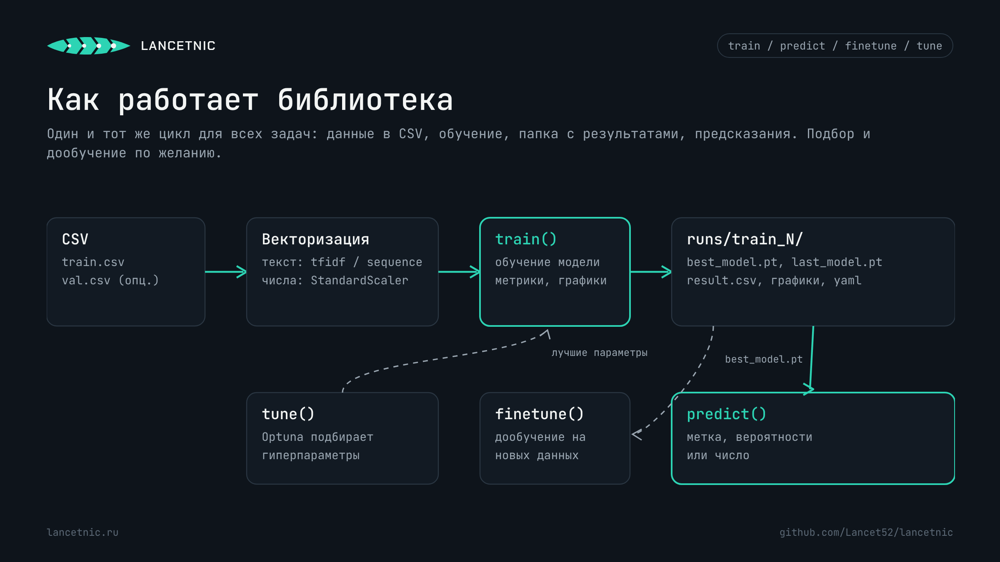
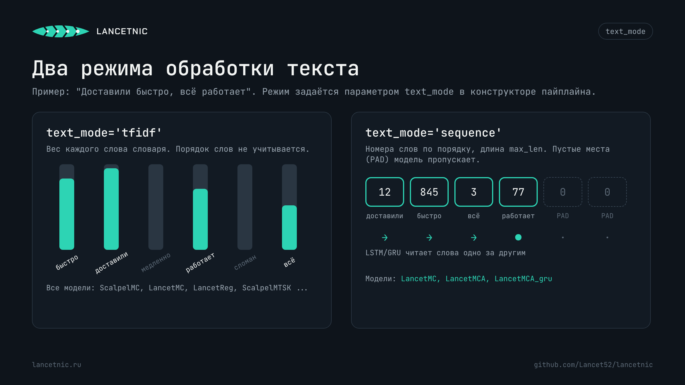
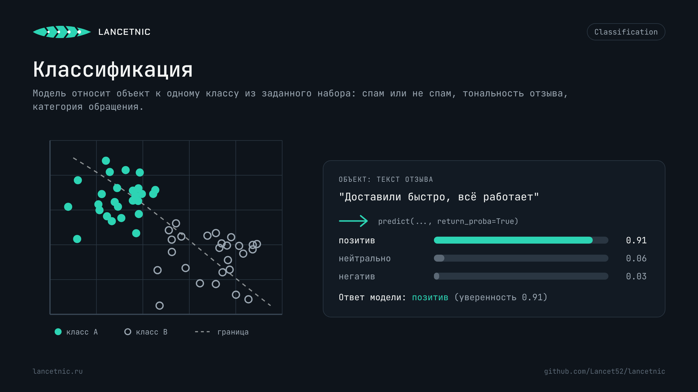
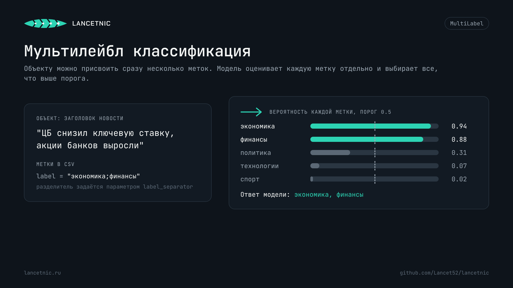
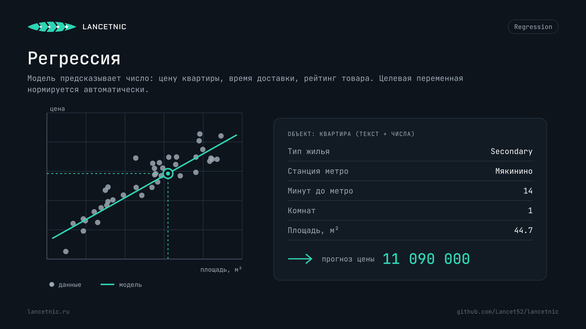
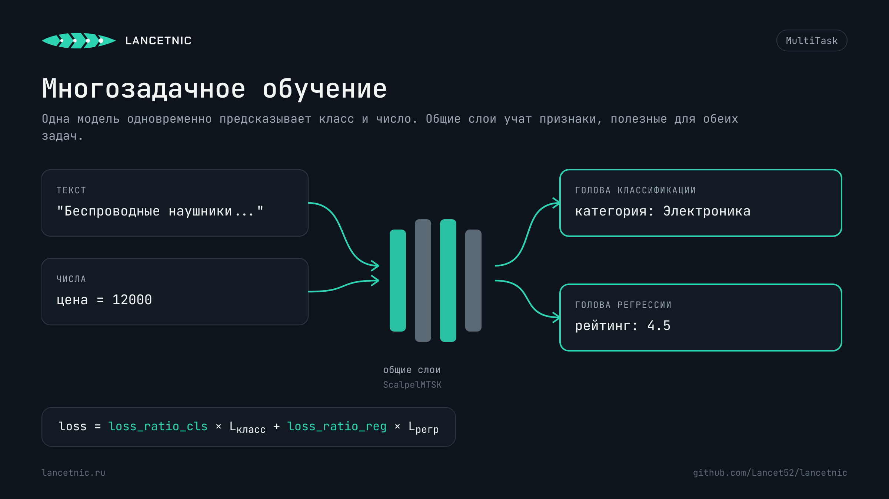

# Документация LANCETNIC 5.0.0

LANCETNIC обучает нейросети на ваших размеченных данных: текстовых, числовых или смешанных. Данные подаются в виде CSV, а библиотека сама векторизует признаки, обучает модель, сохраняет лучшие веса и строит графики метрик.

## Содержание

1. [Установка](#установка)
2. [Быстрый старт](#быстрый-старт)
3. [Как устроена работа](#как-устроена-работа)
4. [Подготовка данных](#подготовка-данных)
5. [Режимы обработки текста](#режимы-обработки-текста)
6. [Классификация](#классификация)
7. [Мультилейбл классификация](#мультилейбл-классификация)
8. [Регрессия](#регрессия)
9. [Многозадачное обучение](#многозадачное-обучение)
10. [Дообучение: finetune](#дообучение-finetune)
11. [Подбор гиперпараметров: tune](#подбор-гиперпараметров-tune)
12. [Встроенные модели](#встроенные-модели)
13. [Своя архитектура модели](#своя-архитектура-модели)
14. [Папка с результатами](#папка-с-результатами)
15. [FAQ](#faq)
16. [Что нового в 5.0.0](#что-нового-в-500)

---

# Установка

Нужен Python 3.10 или новее.

```bash
pip install lancetnic
```

Для обучения на видеокарте NVIDIA установите PyTorch с поддержкой CUDA **до** установки lancetnic. Команду под вашу систему и версию CUDA удобно взять на [pytorch.org](https://pytorch.org/get-started/locally/), например:

```bash
pip install torch --index-url https://download.pytorch.org/whl/cu124
pip install lancetnic
```

Проверить, видит ли PyTorch видеокарту:

```python
import torch
print(torch.cuda.is_available())  # True, если GPU доступен
```

Без GPU библиотека работает на процессоре. Если указать `device_name='cuda'`, а видеокарты нет, обучение автоматически пойдёт на CPU.

---

# Быстрый старт

Обучим классификатор отзывов и сразу получим предсказание.

```python
from lancetnic import Classification
from lancetnic.models import LancetMCA

clf = Classification(text_column=['review'], label_column='label')

clf.train(model_name=LancetMCA,
          train_path='reviews.csv',
          val_path=None,
          num_epochs=20)

# Путь к модели печатается в конце обучения
answer = clf.predict(model_path='runs/train/train_0/best_model.pt',
                     text_data=['Доставили быстро, всё работает'])
print(answer)  # 'позитив'
```

---

# Как устроена работа



Все четыре задачи устроены одинаково:

1. **Создаёте пайплайн** (`Classification`, `MultiLabel`, `Regression` или `MultiTask`) и указываете, какие столбцы CSV являются признаками, а какой столбец является ответом.
2. **Вызываете `train()`**. Библиотека делит данные на обучение и валидацию (или берёт ваш `val_path`), векторизует признаки, обучает модель и складывает результаты в папку `runs/train/train_N/`.
3. **Вызываете `predict()`** с путём к `best_model.pt`. Вместе с моделью сохраняются векторайзеры и кодировщики меток, поэтому на вход подаются обычные строки и числа.
4. **По желанию** подбираете гиперпараметры через `tune()` и дообучаете готовую модель на новых данных через `finetune()`.

---

# Подготовка данных

Обучающий набор хранится в файле `.csv`: одна строка соответствует одному объекту, столбцы содержат признаки и целевую переменную.

| Тип столбца | Параметр | Что происходит при обучении |
|---|---|---|
| Текст | `text_column` | TF-IDF или последовательность номеров слов (см. `text_mode`). Пустые значения заменяются пустой строкой |
| Число | `data_column` | Нормирование `StandardScaler`. Пустые значения заменяются на 0 |
| Метка класса | `label_column`, `label_class` | Кодирование `LabelEncoder` |
| Набор меток | `label_column` в `MultiLabel` | Строка с разделителем, например `"экономика;финансы"` |
| Число-ответ | `label_column` в `Regression`, `label_reg` | Нормирование `StandardScaler`, в предсказании возвращается в исходных единицах |

Правила:

- Каждый текстовый столбец векторизуется отдельно, поэтому порядок столбцов в `text_column` и `data_column` важен: при `predict()` значения передаются в том же порядке.
- В `data_column` указывайте только числовые столбцы. Категории вроде бренда, района или типа жилья передавайте в `text_column`.
- `val_path=None` означает, что валидация будет отрезана от обучающего файла в доле `split_ratio`. Если передан `val_path`, `split_ratio` не используется.
- Все метки классов собираются из обучающей и валидационной частей вместе, поэтому класс, встречающийся только в валидации, тоже попадёт в модель.

---

# Режимы обработки текста



Режим задаётся параметром `text_mode` в конструкторе пайплайна.

| | `text_mode='tfidf'` (по умолчанию) | `text_mode='sequence'` |
|---|---|---|
| Что получает модель | Вес каждого слова словаря | Номера слов в исходном порядке |
| Порядок слов | Не учитывается | Учитывается |
| `max_features` | Размер словаря TF-IDF | Размер словаря: самые частые слова, остальные заменяются служебным `UNK` |
| `max_len` | Не используется | Длина последовательности для одного текстового столбца (по умолчанию 100). Длинные тексты обрезаются, короткие дополняются пустыми местами `PAD` |
| Поддерживаемые модели | Все встроенные модели | `LancetMC`, `LancetMCA`, `LancetMCA_gru` |

Пример включения режима `sequence`:

```python
from lancetnic import Classification
from lancetnic.models import LancetMCA

clf = Classification(text_column=['review'],
                     data_column=['price'],
                     label_column='label',
                     text_mode='sequence',
                     max_len=60,
                     max_features=20000)

clf.train(model_name=LancetMCA, train_path='reviews.csv', val_path=None, num_epochs=15)
```

В режиме `sequence` каждое слово превращается в обучаемый вектор размера `hidden_size`, а LSTM или GRU читает слова по порядку. Пустые места `PAD` модель пропускает. Числовые признаки из `data_column` добавляются к выходу рекуррентного слоя.

Особенности режима `sequence`:

- Текст приводится к нижнему регистру и делится на слова из двух и более букв или цифр. Однобуквенные слова («и», «в», «я») не попадают в словарь. Так же по умолчанию работает и TF-IDF.
- Слова, которых не было в обучающих данных, при `predict()` и `finetune()` превращаются в `UNK`. Словарь фиксируется при первом обучении.

> **Ограничение версии 5.0.0.** Режим `sequence` работает только в задаче **классификации** (`Classification`) с моделями `LancetMC`, `LancetMCA` и `LancetMCA_gru`. С моделями `ScalpelMC`, `LancetReg`, `ScalpelReg`, `ScalpelMTSK`, `ScalpelMLabel`, а значит и в пайплайнах `Regression`, `MultiTask` и `MultiLabel`, обучение завершится ошибкой `TypeError: ... unexpected keyword argument 'vocab_sizes'`. Внутри `tune()` эта ошибка не останавливает подбор: она выводится в строке `✗ Ошибка в trial ...`, а результат trial становится `inf`. Поддержку остальных моделей планируется добавить в следующих версиях. Пока для них используйте `text_mode='tfidf'`.

---

# Классификация



Модель относит объект к одному классу из набора. Подходит для бинарной задачи (спам или не спам) и для многоклассовой (тональность, тематика, категория обращения).

```python
from lancetnic import Classification
```

## Конструктор `Classification()`

| Параметр | Тип | По умолчанию | Описание |
|---|---|---|---|
| `text_column` | list[str] или None | None | Текстовые столбцы |
| `data_column` | list[str] или None | None | Числовые столбцы |
| `label_column` | str | None | Столбец с меткой класса |
| `split_ratio` | float | 0.2 | Доля валидации, если `val_path=None` |
| `random_state` | int | 42 | Seed для разделения на обучение и валидацию |
| `max_features` | int или None | None | Размер словаря. None означает все слова |
| `text_mode` | str | `'tfidf'` | `'tfidf'` или `'sequence'` |
| `max_len` | int | 100 | Длина последовательности для `'sequence'` |

Хотя бы один из параметров `text_column` или `data_column` должен быть задан.

## Метод `train()`

| Параметр | Тип | По умолчанию | Описание |
|---|---|---|---|
| `model_name` | класс | обязательный | `LancetMC`, `LancetMCA`, `LancetMCA_gru`, `ScalpelMC` или своя модель |
| `train_path` | str | обязательный | Путь к обучающему CSV |
| `val_path` | str или None | обязательный | Путь к валидационному CSV или None |
| `num_epochs` | int | обязательный | Количество эпох |
| `hidden_size` | int | 256 | Размер скрытого слоя |
| `num_layers` | int | 1 | Количество слоёв |
| `batch_size` | int | 128 | Размер батча |
| `learning_rate` | float | 0.001 | Скорость обучения |
| `dropout` | float | 0 | Доля отключаемых нейронов, от 0 до 1 |
| `optim_name` | str | `'Adam'` | `'Adam'`, `'RAdam'`, `'SGD'`, `'RMSprop'`, `'Adadelta'` |
| `crit_name` | str | `'CELoss'` | Функция потерь (CrossEntropyLoss) |
| `device_name` | str | `'cuda'` | `'cuda'` или `'cpu'` |
| `folder_name` | str | `'train_'` | Префикс папки с результатами |
| `visualize` | bool | True | Сохранять модели, CSV и графики. При False метод ничего не пишет на диск и возвращает словарь метрик |
| `save_folder_path` | str или None | None | Своя папка для результатов вместо автоматической |

## Метод `predict()`

| Параметр | Тип | По умолчанию | Описание |
|---|---|---|---|
| `model_path` | str | обязательный | Путь к `.pt` |
| `text_data` | list[str] или str | None | Тексты в порядке `text_column`. Если текстовый столбец один, можно передать строку |
| `scalar_data` | list[float] или float | None | Числа в порядке `data_column`. Если числовой столбец один, можно передать число |
| `return_proba` | bool | False | Вернуть вероятности классов |

**Возвращает:**

- при `return_proba=False`: метку класса, например `'позитив'`;
- при `return_proba=True`: словарь
  - `'label'`: метка с наибольшей вероятностью;
  - `'prob'`: вероятность этой метки (уверенность модели);
  - `'probs'`: вероятности всех классов `{класс: вероятность}`, их сумма равна 1.

Для `predict()` конструктор можно вызвать без параметров: всё нужное хранится в файле модели.

## Пример набора данных

| review | price | delivery_days | label |
|---|---|---|---|
| Доставили быстро, всё работает | 1290 | 1 | позитив |
| Пришёл с трещиной на корпусе | 4500 | 6 | негатив |
| Нормальный товар за свои деньги | 890 | 3 | нейтрально |
| Курьер опоздал на два дня, но товар хороший | 2300 | 5 | нейтрально |
| Сломался через неделю, поддержка не отвечает | 3100 | 4 | негатив |
| Отличное качество, закажу ещё | 1750 | 2 | позитив |

## Пример обучения

```python
from lancetnic import Classification
from lancetnic.models import LancetMCA

clf = Classification(
    text_column=['review'],                   # текстовые столбцы
    data_column=['price', 'delivery_days'],   # числовые столбцы
    label_column='label',                     # столбец с классом
    split_ratio=0.2,                          # 20% данных уйдёт в валидацию
    random_state=42,
    max_features=None,                        # использовать все слова
)

clf.train(
    model_name=LancetMCA,
    train_path='reviews.csv',
    val_path=None,
    num_epochs=30,
    hidden_size=256,
    num_layers=1,
    batch_size=128,
    learning_rate=0.001,
    dropout=0.2,
    optim_name='Adam',
    crit_name='CELoss',
    device_name='cuda',
)
```

## Пример предсказания

```python
from lancetnic import Classification

clf = Classification()

label = clf.predict(
    model_path='runs/train/train_0/best_model.pt',
    text_data=['Доставили быстро, всё работает'],
    scalar_data=[1290, 1],
)
print(label)  # 'позитив'

result = clf.predict(
    model_path='runs/train/train_0/best_model.pt',
    text_data=['Доставили быстро, всё работает'],
    scalar_data=[1290, 1],
    return_proba=True,
)
print(result['label'], round(result['prob'], 2))   # позитив 0.91
print(result['probs'])  # {'негатив': 0.03, 'нейтрально': 0.06, 'позитив': 0.91}
```

Вероятности удобно использовать как порог доверия: например, отправлять объект на ручную проверку, если `result['prob'] < 0.6`.

## Модели для классификации

| | `ScalpelMC` | `LancetMC` | `LancetMCA` | `LancetMCA_gru` |
|---|---|---|---|---|
| Архитектура | Полносвязная сеть | LSTM | LSTM + внимание | GRU + внимание |
| `text_mode='sequence'` | ❌ | ✅ | ✅ | ✅ |
| Скорость обучения | Самая высокая | Средняя | Ниже средней | Выше, чем у LSTM |
| Когда выбирать | Табличные данные, TF-IDF, быстрый базовый результат | Тексты, где важен порядок слов | Длинные тексты, где ключевые слова разбросаны | То же, что LancetMCA, при ограниченных ресурсах |

## Файлы результатов

```
runs/train/train_0/
├── best_model.pt                      # модель с наименьшим val_loss
├── last_model.pt                      # модель после последней эпохи
├── hyperparams.yaml                   # параметры запуска
├── result.csv                         # метрики по эпохам
├── confusion_matrix_best_model.png    # матрица ошибок лучшей модели
├── confusion_matrix_last_model.png    # матрица ошибок последней модели
├── train_val_loss.png
├── train_val_acc.png
├── f1_score.png
├── val_precision.png
├── val_recall.png
└── dataset_counts.png                 # распределение классов в обучающем файле
```

Precision, recall и F1 считаются взвешенно по классам (`average='weighted'`).

---

# Мультилейбл классификация



Объекту можно присвоить сразу несколько меток: темы новости, теги товара, симптомы в описании обращения. Модель оценивает вероятность каждой метки отдельно и выбирает все метки выше порога.

```python
from lancetnic import MultiLabel
```

## Конструктор `MultiLabel()`

| Параметр | Тип | По умолчанию | Описание |
|---|---|---|---|
| `text_column` | list[str] или None | None | Текстовые столбцы |
| `data_column` | list[str] или None | None | Числовые столбцы |
| `label_column` | str | None | Столбец с набором меток |
| `label_separator` | str | `';'` | Разделитель меток в строке |
| `split_ratio` | float | 0.2 | Доля валидации |
| `random_state` | int | 42 | Seed |
| `max_features` | int или None | None | Размер словаря |
| `text_mode` | str | `'tfidf'` | В 5.0.0 только `'tfidf'` (см. [ограничение](#режимы-обработки-текста)) |
| `max_len` | int | 100 | Длина последовательности |

Метки в столбце записываются одной строкой через разделитель: `"экономика;финансы"`. Пробелы вокруг меток убираются, пустая ячейка означает объект без меток.

## Метод `train()`

Параметры такие же, как у [`Classification.train()`](#метод-train), со следующими отличиями:

| Параметр | Тип | По умолчанию | Описание |
|---|---|---|---|
| `model_name` | класс | обязательный | `ScalpelMLabel` или своя модель |
| `crit_name` | str | `'BCEWithLogitsLoss'` | Функция потерь |
| `threshold` | float | 0.5 | Порог, выше которого метка считается присвоенной. Сохраняется в модели |

## Метод `predict()`

| Параметр | Тип | По умолчанию | Описание |
|---|---|---|---|
| `model_path` | str | обязательный | Путь к `.pt` |
| `text_data` | list[str] или str | None | Тексты в порядке `text_column` |
| `scalar_data` | list[float] или float | None | Числа в порядке `data_column` |
| `threshold` | float или None | None | Порог. None означает порог, сохранённый при обучении |
| `top_k` | int или None | None | Вернуть ровно `k` самых вероятных меток. Если задан, порог не используется |

**Возвращает** словарь:

- `'labels'`: список выбранных меток;
- `'probs'`: вероятности выбранных меток `{метка: вероятность}`.

## Пример набора данных

| title | tags |
|---|---|
| ЦБ снизил ключевую ставку, акции банков выросли | экономика;финансы |
| Сборная выиграла чемпионат Европы по волейболу | спорт |
| Правительство одобрило закон о цифровом рубле | политика;финансы;технологии |
| Новый смартфон получил камеру на 200 Мп | технологии |
| Выборы мэра пройдут в сентябре | политика |

## Пример обучения и предсказания

```python
from lancetnic import MultiLabel
from lancetnic.models import ScalpelMLabel

ml = MultiLabel(text_column=['title'],
                label_column='tags',
                label_separator=';',
                max_features=10000)

ml.train(model_name=ScalpelMLabel,
         train_path='news.csv',
         val_path=None,
         num_epochs=40,
         hidden_size=256,
         num_layers=2,
         dropout=0.3,
         threshold=0.5)

result = ml.predict(model_path='runs/train/train_0/best_model.pt',
                    text_data=['ЦБ снизил ключевую ставку, акции банков выросли'])
print(result)
# {'labels': ['финансы', 'экономика'], 'probs': {'финансы': 0.88, 'экономика': 0.94}}

top2 = ml.predict(model_path='runs/train/train_0/best_model.pt',
                  text_data=['Правительство одобрило закон о цифровом рубле'],
                  top_k=2)
```

## Метрики

| Метрика | Что показывает |
|---|---|
| Subset accuracy | Доля объектов, у которых угадан **весь** набор меток |
| Hamming loss | Доля ошибочных меток среди всех пар «объект, метка». Чем меньше, тем лучше |
| Precision, Recall, F1 (samples) | Считаются для каждого объекта и усредняются |
| Per-class F1 | F1 отдельно по каждой метке на последней эпохе |

## Файлы результатов

```
runs/train/train_0/
├── best_model.pt
├── last_model.pt
├── hyperparams.yaml
├── result.csv
├── confusion_matrix_best_model.png    # сколько раз истинная метка i встречалась с предсказанной j
├── confusion_matrix_last_model.png
├── train_val_loss.png
├── multi_label_subset_acc.png
├── hamming_loss.png
├── multi_label_prf.png                # precision, recall и F1 на одном графике
├── per_class_f1.png
└── label_distribution.png             # сколько меток бывает у одного объекта
```

---

# Регрессия



Модель предсказывает число: цену, время, рейтинг, объём. Целевая переменная перед обучением нормируется, а `predict()` возвращает значение в исходных единицах.

```python
from lancetnic import Regression
```

## Конструктор `Regression()`

| Параметр | Тип | По умолчанию | Описание |
|---|---|---|---|
| `text_column` | list[str] или None | None | Текстовые и категориальные столбцы |
| `data_column` | list[str] или None | None | Числовые столбцы |
| `label_column` | str | None | Столбец с числом, которое нужно предсказать |
| `split_ratio` | float | 0.2 | Доля валидации |
| `random_state` | int | 42 | Seed |
| `max_features` | int или None | None | Размер словаря |
| `text_mode` | str | `'tfidf'` | В 5.0.0 только `'tfidf'` (см. [ограничение](#режимы-обработки-текста)) |
| `max_len` | int | 100 | Длина последовательности |

## Метод `train()`

Параметры такие же, как у [`Classification.train()`](#метод-train), со следующими отличиями:

| Параметр | Тип | По умолчанию | Описание |
|---|---|---|---|
| `model_name` | класс | обязательный | `ScalpelReg`, `LancetReg` или своя модель |
| `crit_name` | str | `'MSELoss'` | `'MSELoss'`, `'L1Loss'`, `'SmoothL1Loss'` |

`L1Loss` и `SmoothL1Loss` меньше реагируют на выбросы, чем `MSELoss`.

## Метод `predict()`

| Параметр | Тип | По умолчанию | Описание |
|---|---|---|---|
| `model_path` | str | обязательный | Путь к `.pt` |
| `text_data` | list[str] или str | None | Тексты в порядке `text_column` |
| `scalar_data` | list[float] или float | None | Числа в порядке `data_column` |

**Возвращает** число `float` в единицах целевого столбца.

## Пример набора данных

| Price | Apartment_type | Metro_station | Minutes_to_metro | Region | Number_of_rooms | Area | Living_area |
|---|---|---|---|---|---|---|---|
| 6300000.0 | Secondary | Опалиха | 6.0 | Moscow region | 1.0 | 30.6 | 11.1 |
| 9000000.0 | Secondary | Павшино | 2.0 | Moscow region | 1.0 | 49.2 | 20.0 |
| 11090000.0 | Secondary | Мякинино | 14.0 | Moscow region | 1.0 | 44.7 | 16.2 |
| 8300000.0 | Secondary | Строгино | 8.0 | Moscow region | 1.0 | 35.1 | 16.0 |
| 7400000.0 | Secondary | Нахабино | 11.0 | Moscow region | 1.0 | 33.0 | 16.0 |
| 7800000.0 | Secondary | Красногорская | 6.0 | Moscow region | 1.0 | 41.8 | 18.0 |

## Пример обучения и предсказания

```python
from lancetnic import Regression
from lancetnic.models import ScalpelReg

reg = Regression(
    text_column=['Apartment_type', 'Metro_station', 'Region'],
    data_column=['Minutes_to_metro', 'Number_of_rooms', 'Area', 'Living_area'],
    label_column='Price',
    split_ratio=0.2,
    random_state=42,
)

reg.train(model_name=ScalpelReg,
          train_path='moscow_flats.csv',
          val_path=None,
          num_epochs=50,
          hidden_size=256,
          num_layers=2,
          batch_size=256,
          learning_rate=0.001,
          dropout=0.1,
          crit_name='MSELoss')

price = Regression().predict(
    model_path='runs/train/train_0/best_model.pt',
    text_data=['Secondary', 'Мякинино', 'Moscow region'],
    scalar_data=[14.0, 1.0, 44.7, 16.2],
)
print(f'{price:,.0f}')
```

## Модели для регрессии

| | `ScalpelReg` | `LancetReg` |
|---|---|---|
| Архитектура | Полносвязная сеть | LSTM |
| Скорость обучения | Высокая | Ниже |
| Когда выбирать | Табличные данные и TF-IDF, хороший выбор по умолчанию | Эксперименты с рекуррентной архитектурой |

## Метрики и файлы результатов

`loss` считается на нормированной целевой переменной, а MAE и RMSE в `result.csv` и на графиках показаны в исходных единицах (например, в рублях).

```
runs/train/train_0/
├── best_model.pt
├── last_model.pt
├── hyperparams.yaml
├── result.csv
├── train_val_loss.png
├── train_val_mae.png
├── train_val_rmse.png
└── regression_scatter.png    # предсказание против факта, линия y = x, MAE, RMSE, R²
```

---

# Многозадачное обучение



Одна модель одновременно предсказывает класс и число: категорию товара и его рейтинг, тип заявки и время её выполнения. Общие слои учат признаки, полезные для обеих задач, а две «головы» выдают ответы.

```python
from lancetnic import MultiTask
```

## Конструктор `MultiTask()`

| Параметр | Тип | По умолчанию | Описание |
|---|---|---|---|
| `text_column` | list[str] или None | None | Текстовые и категориальные столбцы |
| `data_column` | list[str] или None | None | Числовые столбцы |
| `label_class` | str | None | Столбец с классом |
| `label_reg` | str | None | Столбец с числом |
| `split_ratio` | float | 0.2 | Доля валидации |
| `random_state` | int | 42 | Seed |
| `max_features` | int или None | None | Размер словаря |
| `text_mode` | str | `'tfidf'` | В 5.0.0 только `'tfidf'` (см. [ограничение](#режимы-обработки-текста)) |
| `max_len` | int | 100 | Длина последовательности |

## Метод `train()`

Общие параметры такие же, как у [`Classification.train()`](#метод-train). Вместо `crit_name` используются:

| Параметр | Тип | По умолчанию | Описание |
|---|---|---|---|
| `model_name` | класс | обязательный | `ScalpelMTSK` или своя модель |
| `crit_cls_name` | str | `'CELoss'` | Функция потерь для класса |
| `crit_reg_name` | str | `'MSELoss'` | Функция потерь для числа: `'MSELoss'`, `'L1Loss'`, `'SmoothL1Loss'` |
| `loss_ratio_cls` | float | 1.0 | Вес потерь классификации |
| `loss_ratio_reg` | float | 1.0 | Вес потерь регрессии |

Итоговая функция потерь:

```
loss = loss_ratio_cls * loss_класс + loss_ratio_reg * loss_регрессия
```

Подбор весов:

- `1.0` и `1.0`: обе задачи равноценны (по умолчанию);
- `1.0` и `0.3`: приоритет классификации;
- `0.3` и `1.0`: приоритет регрессии.

Если одна из метрик заметно хуже, чем у отдельной модели, увеличьте вес этой задачи.

## Метод `predict()`

Параметры: `model_path`, `text_data`, `scalar_data`, как в регрессии.

**Возвращает** кортеж `(класс, число)`, где число указано в исходных единицах.

## Пример набора данных

| description | brand | price | category | rating |
|---|---|---|---|---|
| Смартфон с отличной камерой и долгим временем работы | Samsung | 45000 | Электроника | 4.5 |
| Удобные кроссовки для бега с амортизацией | Nike | 8500 | Обувь | 4.2 |
| Книга по программированию на Python | Питер | 1200 | Книги | 4.8 |
| Кофемашина автоматическая с капучинатором | DeLonghi | 35000 | Бытовая техника | 4.6 |
| Беспроводные наушники с шумоподавлением | Sony | 12000 | Электроника | 4.5 |
| Зимняя куртка с меховым воротником | Columbia | 15000 | Одежда | 4.4 |

## Пример обучения и предсказания

```python
from lancetnic import MultiTask
from lancetnic.models import ScalpelMTSK

mt = MultiTask(text_column=['description', 'brand'],
               data_column=['price'],
               label_class='category',
               label_reg='rating',
               max_features=5000)

mt.train(model_name=ScalpelMTSK,
         train_path='products.csv',
         val_path=None,
         num_epochs=50,
         hidden_size=256,
         num_layers=2,
         batch_size=64,
         dropout=0.3,
         crit_cls_name='CELoss',
         crit_reg_name='MSELoss',
         loss_ratio_cls=1.0,
         loss_ratio_reg=0.5)

category, rating = MultiTask().predict(
    model_path='runs/train/train_0/best_model.pt',
    text_data=['Беспроводные наушники с шумоподавлением', 'Sony'],
    scalar_data=[12000],
)
print(category, round(rating, 2))   # Электроника 4.5
```

## Модель

| | `ScalpelMTSK` |
|---|---|
| Архитектура | Общие полносвязные слои и две головы: классификация и регрессия |
| Когда выбирать | Класс и число связаны между собой, данных хватает для обеих задач |

## Файлы результатов

```
runs/train/train_0/
├── best_model.pt
├── last_model.pt
├── hyperparams.yaml
├── result.csv
├── confusion_matrix_best_model.png
├── confusion_matrix_last_model.png
├── train_val_loss.png                 # суммарная функция потерь
├── train_val_acc.png
├── f1_score.png
├── train_val_mae.png
├── train_val_rmse.png
└── regression_scatter.png
```

---

# Дообучение: finetune

`finetune()` продолжает обучение уже сохранённой модели на новых данных. Это удобно, когда накопились свежие размеченные примеры, а обучать с нуля долго.

Как это работает:

- модель, векторайзеры и кодировщики меток берутся из файла `.pt`; словарь слов **не расширяется**, новые слова в TF-IDF игнорируются, а в `sequence` превращаются в `UNK`;
- архитектура (`hidden_size`, `num_layers`) тоже берётся из файла. Если передать другие значения, появится предупреждение, и они будут проигнорированы;
- `dropout=None` (по умолчанию) сохраняет dropout, с которым модель обучалась. Передайте число, чтобы его изменить;
- в новых данных не должно быть классов, которых не было при первом обучении;
- результаты сохраняются в `runs/finetune/finetune_N/` с тем же набором файлов, что и при `train()`.

Конструктор пайплайна нужно создать **с теми же столбцами**, что и при первом обучении.

## Параметры

| Параметр | По умолчанию | Описание |
|---|---|---|
| `pretrained_path` | обязательный | Путь к `.pt` |
| `train_path` | обязательный | Новые обучающие данные |
| `val_path` | None | Валидация. При None используется `split_ratio` из конструктора |
| `num_epochs` | 10 | Количество эпох |
| `hidden_size`, `num_layers` | None | Не используются, архитектура берётся из модели |
| `batch_size` | 128 | Размер батча |
| `learning_rate` | 0.0001 | Обычно в 10 раз меньше, чем при обучении с нуля |
| `dropout` | None | None оставляет dropout модели, число задаёт новый |
| `optim_name` | `'Adam'` | Оптимизатор |
| `device_name` | `'cuda'` | Устройство |

Дополнительно по задачам:

| Пайплайн | Параметры |
|---|---|
| `Classification` | `crit_name='CELoss'` |
| `MultiLabel` | `crit_name='BCEWithLogitsLoss'`, `threshold=None` (None оставляет порог модели) |
| `Regression` | `crit_name='MSELoss'` |
| `MultiTask` | `crit_cls_name='CELoss'`, `crit_reg_name='MSELoss'`, `loss_ratio_cls=1.0`, `loss_ratio_reg=1.0` |

## Пример

```python
from lancetnic import Classification

clf = Classification(text_column=['review'],
                     data_column=['price', 'delivery_days'],
                     label_column='label')

clf.finetune(pretrained_path='runs/train/train_0/best_model.pt',
             train_path='reviews_november.csv',
             num_epochs=5,
             learning_rate=0.0001)
```

---

# Подбор гиперпараметров: tune

`tune()` перебирает гиперпараметры с помощью [Optuna](https://optuna.org/) (алгоритм TPE) и находит сочетание с наименьшим `val_loss`. Каждая итерация обучает модель с нуля, поэтому для подбора берите небольшое `num_epoch`, а финальную модель обучайте отдельно через `train()` с найденными параметрами.

## Параметры

| Параметр | По умолчанию | Описание |
|---|---|---|
| `model_name` | обязательный | Класс модели |
| `train_path` | обязательный | Обучающие данные |
| `val_path` | обязательный | Валидация или None |
| `iterations` | обязательный | Количество попыток (trial) |
| `num_epoch` | обязательный | Эпох в каждой попытке |
| `hidden_size_range` | `[64, 128, 256]` | Варианты размера скрытого слоя |
| `num_layers_range` | `[1, 2, 3]` | Варианты количества слоёв |
| `learning_rate_range` | `(1e-5, 1e-2)` | Диапазон скорости обучения, перебирается в логарифмической шкале |
| `dropout_range` | `(0.0, 0.5)` | Диапазон dropout |
| `batch_size_range` | `[32, 64, 128]` | Варианты размера батча |
| `optim_name` | `'Adam'` | Оптимизатор |
| `device_name` | `'cuda'` | Устройство |
| `seed` | None | Число для воспроизводимого подбора |

Функции потерь передаются так же, как в `train()` соответствующей задачи: `crit_name` для `Classification`, `MultiLabel` и `Regression`, а для `MultiTask` параметры `crit_cls_name`, `crit_reg_name`, `loss_ratio_cls` и `loss_ratio_reg`.

**Возвращает** словарь лучших параметров. Его можно сразу передать в `train()`, переименовав ключи `num_epochs`, `optimizer` и `criterion`, либо переписать значения вручную.

## Пример

```python
from lancetnic import Classification
from lancetnic.models import LancetMCA

clf = Classification(text_column=['review'], label_column='label')

best = clf.tune(model_name=LancetMCA,
                train_path='reviews.csv',
                val_path=None,
                iterations=30,
                num_epoch=5,
                hidden_size_range=[128, 256],
                num_layers_range=[1, 2],
                seed=42)

print(best)
# {'hidden_size': 256, 'num_layers': 1, 'learning_rate': 0.0021, 'dropout': 0.18,
#  'batch_size': 64, 'num_epochs': 5, 'optimizer': 'Adam', 'criterion': 'CELoss'}

clf.train(model_name=LancetMCA,
          train_path='reviews.csv',
          val_path=None,
          num_epochs=30,
          hidden_size=best['hidden_size'],
          num_layers=best['num_layers'],
          learning_rate=best['learning_rate'],
          dropout=best['dropout'],
          batch_size=best['batch_size'])
```

Подбор можно остановить через `Ctrl+C`: результаты завершённых попыток сохранятся.

## Файлы результатов

Модели во время подбора не сохраняются, только параметры и метрики:

```
runs/tune/tune_0/
├── result_tune.csv                     # все попытки: min_val_loss и параметры
├── best_hyperparams.yaml               # лучшая попытка
└── trials/
    ├── tune_hyperparams_trial_1.yaml
    ├── tune_hyperparams_trial_2.yaml
    └── ...
```

---

# Встроенные модели

```python
from lancetnic.models import (LancetMC, LancetMCA, LancetMCA_gru, ScalpelMC,
                              LancetReg, ScalpelReg,
                              ScalpelMTSK,
                              ScalpelMLabel)
```

Названия моделей отсылают к хирургическим инструментам: **Scalpel** обозначает простые и быстрые полносвязные сети, **Lancet** обозначает рекуррентные сети (LSTM и GRU).

| Модель | Задача | Архитектура | `sequence` |
|---|---|---|---|
| `ScalpelMC` | Классификация | Полносвязная сеть | ❌ |
| `LancetMC` | Классификация | LSTM | ✅ |
| `LancetMCA` | Классификация | LSTM + внимание | ✅ |
| `LancetMCA_gru` | Классификация | GRU + внимание | ✅ |
| `ScalpelMLabel` | Мультилейбл | Полносвязная сеть | ❌ |
| `ScalpelReg` | Регрессия | Полносвязная сеть | ❌ |
| `LancetReg` | Регрессия | LSTM | ❌ |
| `ScalpelMTSK` | Мультизадача | Общие полносвязные слои и две головы | ❌ |

Общие параметры, которые задаются в `train()`:

- `hidden_size`: размер скрытого слоя. В режиме `sequence` это ещё и размер вектора одного слова;
- `num_layers`: количество скрытых слоёв (у LSTM и GRU количество рекуррентных слоёв);
- `dropout`: у LSTM и GRU dropout между рекуррентными слоями включается только при `num_layers > 1`.

Какую модель выбрать для начала:

- **табличные данные или короткие тексты**: `ScalpelMC` / `ScalpelReg`, они быстро дают базовый результат;
- **тексты, где важен порядок слов**: `LancetMCA` с `text_mode='sequence'`;
- **мало памяти или нужна скорость при рекуррентной архитектуре**: `LancetMCA_gru`.

---

# Своя архитектура модели

В `model_name` можно передать свой класс на PyTorch. Пайплайн создаёт модель так:

```python
model = model_name(input_size, hidden_size, num_layers, num_classes, dropout)
```

| Пайплайн | 4-й аргумент | Что возвращает `forward(x)` |
|---|---|---|
| `Classification` | `num_classes` | Логиты `[B, num_classes]` без softmax |
| `MultiLabel` | `num_classes` | Логиты `[B, num_classes]` без sigmoid |
| `Regression` | `output_size` (равен 1) | `[B, 1]` |
| `MultiTask` | `num_classes` | Кортеж `(логиты [B, num_classes], число [B, 1])` |

На вход `forward` приходит тензор `x` формы `[B, input_size]`. Для режима `text_mode='sequence'` конструктор должен дополнительно принимать именованные параметры `vocab_sizes` и `max_len` (пример: `LancetMC` в `lancetnic/models/class_model.py` и слой `TokenEmbedding` в `lancetnic/models/layers.py`).

Пример простой модели для классификации:

```python
import torch
import torch.nn as nn
from lancetnic import Classification


class MyNet(nn.Module):
    def __init__(self, input_size: int, hidden_size: int, num_layers: int,
                 num_classes: int, dropout: float) -> None:
        super().__init__()
        self.net = nn.Sequential(
            nn.Linear(input_size, hidden_size),
            nn.GELU(),
            nn.Dropout(dropout),
            nn.Linear(hidden_size, num_classes),
        )

    def forward(self, x: torch.Tensor) -> torch.Tensor:
        return self.net(x)


clf = Classification(text_column=['review'], label_column='label')
clf.train(model_name=MyNet, train_path='reviews.csv', val_path=None, num_epochs=20)
```

Модель сохраняется в `.pt` целиком, поэтому при `predict()` класс `MyNet` должен быть доступен для импорта в том же виде.

---

# Папка с результатами

Каждый запуск создаёт новую пронумерованную папку в текущей рабочей директории:

```
runs/
├── train/
│   ├── train_0/
│   └── train_1/
├── finetune/
│   └── finetune_0/
└── tune/
    └── tune_0/
```

Префикс меняется параметром `folder_name` в `train()`: при `folder_name='reviews_'` результаты попадут в `runs/reviews/reviews_0/`.

Что хранится в файле модели `.pt`:

- сама модель (архитектура и веса);
- векторайзеры текста и числовых признаков;
- кодировщик меток (`LabelEncoder` или `MultiLabelBinarizer`) и нормировщик целевой переменной для регрессии;
- служебные параметры: `input_size`, `hidden_size`, `num_layers`, эпоха и `val_loss`, а для мультилейбла ещё порог.

`best_model.pt` перезаписывается каждый раз, когда `val_loss` становится меньше прежнего минимума. `last_model.pt` перезаписывается после каждой эпохи.

> Файлы `.pt` загружаются через `torch.load(..., weights_only=False)`, а значит могут исполнять код. Открывайте только модели из надёжных источников.

---

# FAQ

### Какие форматы данных поддерживаются?

CSV. Одна строка соответствует одному объекту, столбцы содержат признаки и целевую переменную. Кодировку лучше использовать UTF-8.

### Сколько нужно данных?

Для классификации ориентируйтесь хотя бы на несколько сотен примеров на класс. Для мультилейбла желательно, чтобы каждая метка встречалась не меньше нескольких десятков раз. Распределение классов видно на графике `dataset_counts.png`.

### Как выбрать гиперпараметры?

Начните с `hidden_size=256`, `num_layers=1`, `dropout=0.2`, `learning_rate=0.001`. Если `val_loss` начинает расти, а `train_loss` продолжает падать, модель переобучается: увеличьте `dropout` или уменьшите `hidden_size`. Для автоматического подбора используйте [`tune()`](#подбор-гиперпараметров-tune).

### Модель плохо обучается. Что проверить?

- дисбаланс классов (`dataset_counts.png`);
- слишком большой или слишком маленький `learning_rate`;
- мало эпох: посмотрите, падает ли ещё `val_loss` на графике `train_val_loss.png`;
- числовые столбцы, случайно указанные в `text_column`, или текстовые в `data_column`.

### Как получить уверенность модели?

В классификации вызовите `predict(..., return_proba=True)`. В мультилейбле вероятности выбранных меток всегда возвращаются в `'probs'`.

### Можно ли продолжить обучение сохранённой модели?

Да, с версии 5.0.0 через [`finetune()`](#дообучение-finetune).

### Как ускорить обучение?

Установите PyTorch с поддержкой CUDA, увеличьте `batch_size`, если хватает видеопамяти, ограничьте словарь через `max_features` и начните с моделей `Scalpel*`.

### Почему `text_mode='sequence'` выдаёт `TypeError ... 'vocab_sizes'`?

В версии 5.0.0 режим `sequence` поддерживают только `LancetMC`, `LancetMCA` и `LancetMCA_gru` в задаче классификации. Для остальных моделей используйте `text_mode='tfidf'`. Подробнее в разделе [Режимы обработки текста](#режимы-обработки-текста).

### Как предсказать сразу много объектов?

`predict()` обрабатывает один объект за вызов. Для пакетной обработки вызывайте его в цикле, например по строкам `DataFrame`.

---

# Что нового в 5.0.0

- **Мультилейбл классификация**: пайплайн `MultiLabel` и модель `ScalpelMLabel`.
- **Режим `text_mode='sequence'`**: модели `LancetMC`, `LancetMCA` и `LancetMCA_gru` читают слова по порядку, а внимание пропускает пустые места. Новые параметры `text_mode` и `max_len`.
- **Вероятности классов**: `Classification.predict(..., return_proba=True)`.
- **Дообучение** готовых моделей через `finetune()` во всех пайплайнах. Dropout модели по умолчанию сохраняется.
- **Подбор гиперпараметров** через `tune()` на базе Optuna во всех пайплайнах.
- **Регрессия**: целевая переменная нормируется автоматически, `predict()` возвращает значение в исходных единицах, MAE и RMSE тоже показываются в исходных единицах.
- **Новые параметры `train()`**: `folder_name`, `visualize` и `save_folder_path`.
- **Структура папки `runs/`** изменилась: результаты обучения теперь лежат в `runs/train/train_N/` (раньше `runs/train_N/`), дообучения в `runs/finetune/`, подбора в `runs/tune/`.
